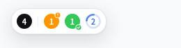
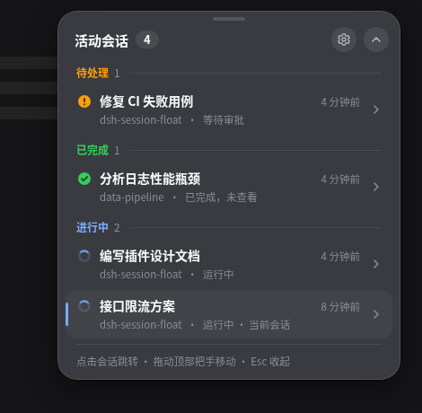
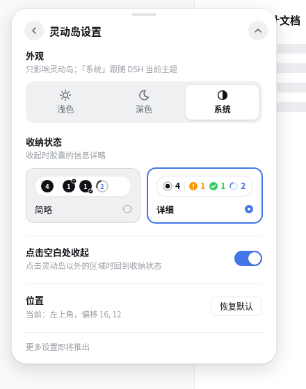

# dsh-session-float

[DeepSeek Harness](https://github.com/deepseek-ai/deepseek-harness) Web 界面的活动会话"灵动岛"。它浮在页面上，显示当前有几个会话在待处理、已完成、进行中；点击展开查看详情，再点击某个会话就能直接跳转过去。

## 功能

- **一眼看清活动会话**：收纳态显示活动会话总数，以及待处理、已完成、进行中各有几个。数量为 0 的状态不显示。
- **两种收纳样式**：详细（图标 + 数字 + 文字）或简略（数字写在状态图标中心）。
- **按优先级分组的会话列表**：展开后按待处理 → 已完成 → 进行中排列，组内按最近活动排序，当前打开的会话带竖条标记。
- **一键跳转**：点击列表中的会话，直接切换到该会话。
- **随意摆放**：按住拖动到任意位置。在左侧时向右展开、向左收拢，在右侧时向左展开、向右收拢；位置会被记住。
- **外观**：浅色、深色（比 DSH 深色亮一级，便于区分）、系统（跟随 DSH 当前主题）。
- **收起方式**：可选点击空白处收起；Esc、收起按钮、点击会话也会收起。
- **流畅的过渡动画**：展开、收起、数字变化都有弹性动画，并遵循系统的「减少动态效果」设置。

状态与侧边栏的会话状态点一致：

| 状态 | 含义 |
|---|---|
| 待处理 | 会话在等你审批、审阅计划或回答问题 |
| 已完成 | 会话运行结束，你还没打开查看 |
| 进行中 | 会话正在运行 |

## 安装

需要 DeepSeek Harness `0.2.1-rc.2` 及以上。

安装最新发布版：

```sh
dsh plugin --profile web add github:MorzerChimes/dsh-session-float
```

安装指定版本：

```sh
dsh plugin --profile web add github:MorzerChimes/dsh-session-float#v0.1.0
```

所有版本见 [Tags](https://github.com/MorzerChimes/dsh-session-float/tags)。安装后刷新 DSH 页面即可看到；如果没有出现，重启 `dsh web`。

设置入口有两个：展开面板头部的齿轮，以及侧栏「插件 → dsh-session-float」的详情页。

卸载：

```sh
dsh plugin --profile web remove dsh-session-float
```

## 效果预览

收纳态（详细 / 简略）：




展开后的会话列表（浅色，左上角） / 深色外观停靠在右上角时向左展开：

<p>
  
  
</p>

灵动岛设置：



## 更新记录

### v0.1.0（2026-10-29）

首个发布版本：收纳态胶囊（详细 / 简略）、分组会话列表与一键跳转、拖动与按角展开、浅色 / 深色 / 系统外观、点击空白处收起、岛内与插件页两处设置入口、过渡动画、中英文界面。

完整记录见 [CHANGELOG.md](CHANGELOG.md)。

## 许可

[MIT](LICENSE) © Merlin Hermes

开发、构建与发布说明见 [docs/](docs/README.md)。
